<div align="center">


# CorLink

**Web Bluetooth companion application and multimodal AI interface for the Cortex S3 AI smartwatch.**

[](https://developer.mozilla.org/en-US/docs/Web/API/Web_Bluetooth_API)
[](https://www.seeedstudio.com/XIAO-ESP32S3-Sense-p-5639.html)
[](https://sumitrawat2417.github.io/corlink-public/)
[](LICENSE)

**[Launch Live App](https://sumitrawat2417.github.io/corlink-public/)** · [Report a Bug](https://github.com/sumitrawat2417/corlink/issues) · [Request a Feature](https://github.com/sumitrawat2417/corlink/issues)

</div>

---

## Overview

**CorLink** is a progressive web companion application designed for the **Cortex S3 AI** autonomous smartwatch (built on the Seeed Studio XIAO ESP32-S3 Sense platform). It provides an on-device control surface, spatial telemetry monitor, and edge AI routing hub that connects directly to the wearable hardware over low-latency Web Bluetooth (BLE 5.0).

**The problem:** Smartwatch companion ecosystems traditionally require heavy native operating system wrappers, vendor lock-in, and centralized cloud servers that harvest sensitive voice recordings, camera frames, and personal credentials.

**The approach:** CorLink operates entirely client-side in standard Chromium-based browsers without an intermediate backend server. Voice transcriptions, vision inference requests, encrypted password credentials, alarms, and QR cards are processed in memory and persisted directly to on-device browser storage (`localStorage`), giving users complete data ownership and offline resilience.

---

## System Architecture

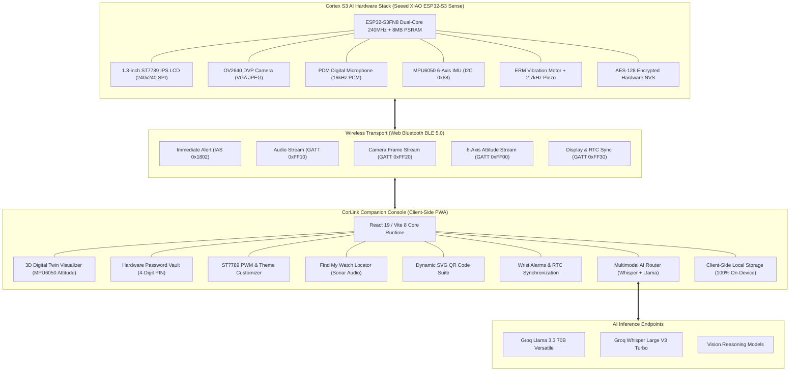

---

## Interface Gallery & Visual Overview

| Wearable Hub Dashboard | Spatial Radar HUD & Proximity |
| :---: | :---: |
| 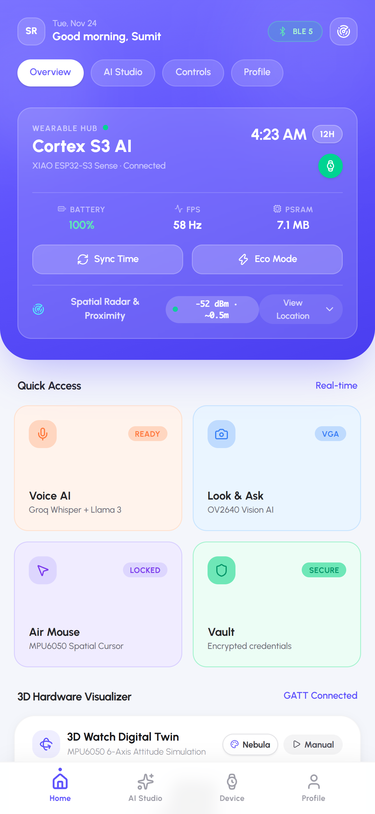 | 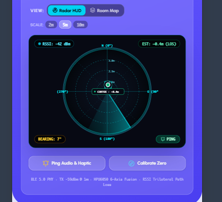 |
| *Real-time telemetry, battery monitor, clock capsule, and quick actions* | *Precision SVG radar scope with RSSI path-loss distance & IMU compass heading* |

| 3D Watch Digital Twin | ST7789 Display & Watchface Customizer |
| :---: | :---: |
| 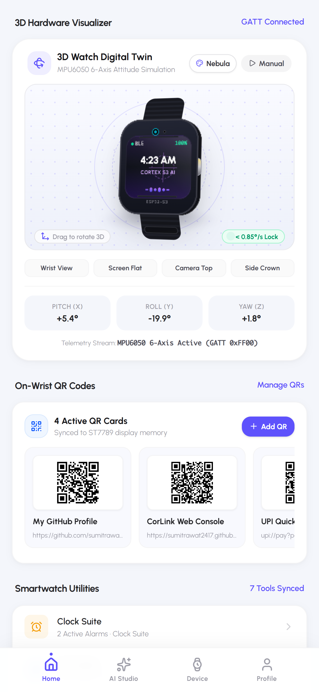 | 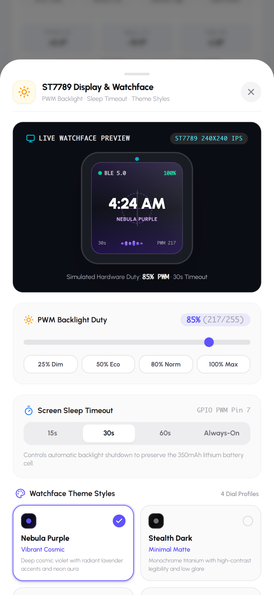 |
| *Interactive 3D chassis with live MPU6050 Euler attitude streaming* | *PWM backlight duty slider (10%-100%), sleep timeout & 4 dial themes* |

| Find My Smartwatch Locator | Hardware Password Vault |
| :---: | :---: |
| 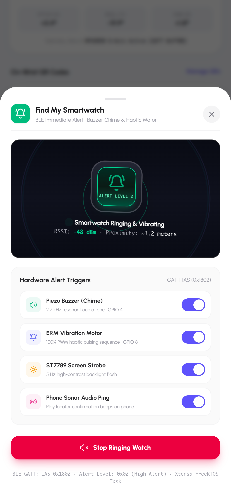 | 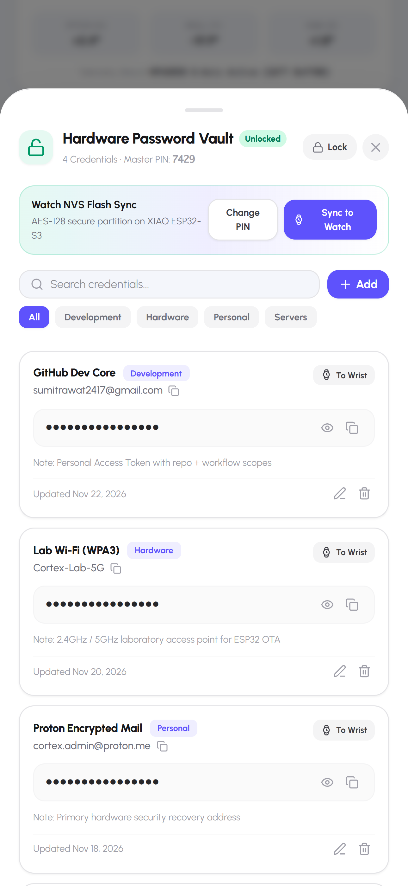 |
| *IAS 0x1802 High Alert, 2.7kHz piezo buzzer, ERM haptic & sonar audio pings* | *4-digit master PIN (7429), credential CRUD, generator & AES-128 NVS sync* |

| Wrist Alarms & Chimes Suite | Wrist QR Code Manager |
| :---: | :---: |
| 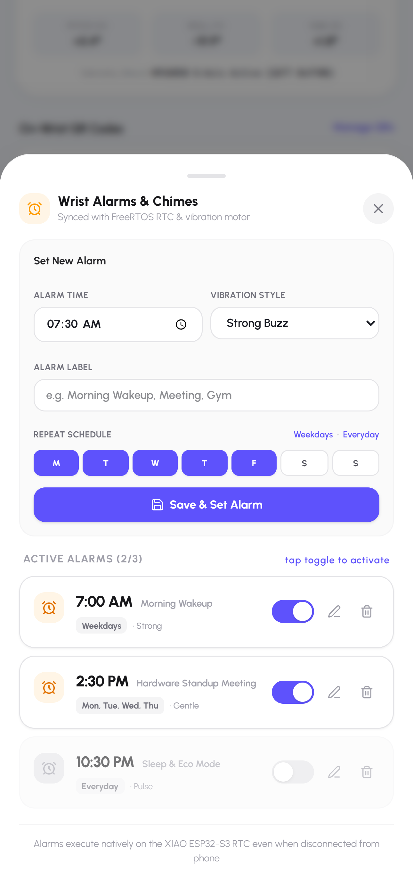 | 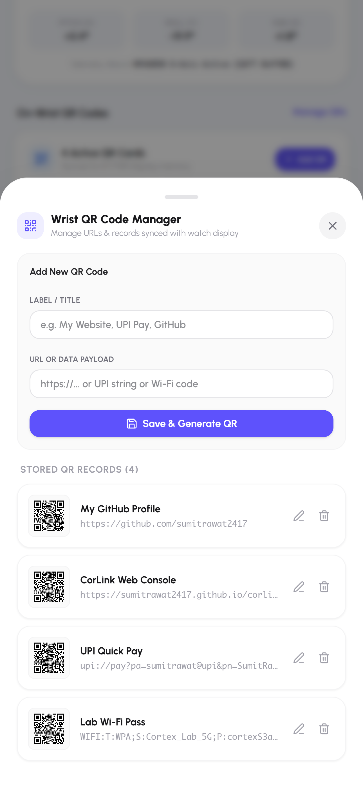 |
| *FreeRTOS RTC alarm scheduling, multi-day repeating & vibration intensity* | *Dynamic vector SVG QR generation for UPI, Wi-Fi keys, and web URLs* |

| Multimodal AI Voice Assistant | Look & Ask Vision Pipeline |
| :---: | :---: |
| 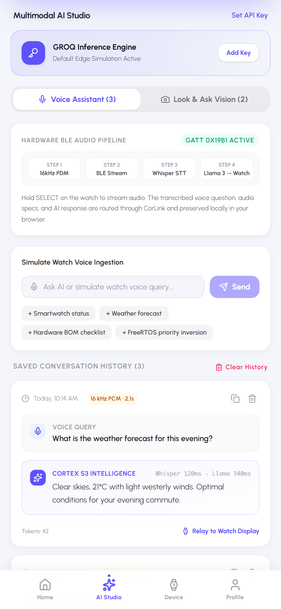 | 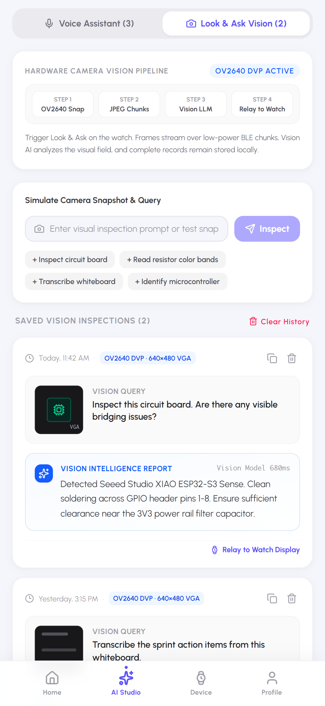 |
| *16 kHz PCM stream relay, Groq Whisper STT, Llama-3.3-70B reasoning & watch reply* | *OV2640 VGA frame capture, visual circuit board inspection & reports* |

<div align="center">

### User Profile & Diagnostics Console
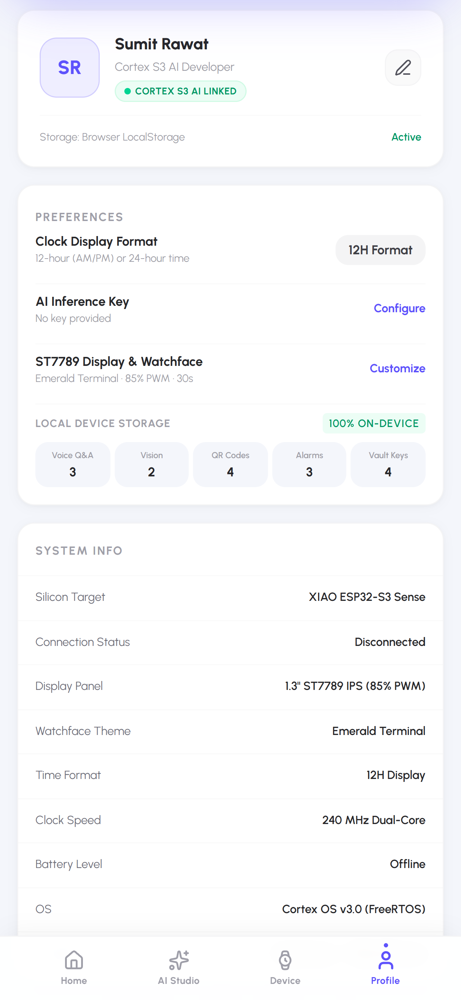
<br>
<em>Identity management, 12H/24H format preferences, local storage counters, and system hardware specifications</em>

</div>

---

## Features

### 1. Multimodal AI Studio
- **Voice Assistant Stream Relay:** Decouples 16 kHz 16-bit PCM chunked audio streamed from the watch microphone, coordinates cloud/edge transcription via Whisper V3 Turbo, queries Llama-3.3-70B, logs conversation history locally, and transmits formatted text responses back to the watch ST7789 screen.
- **Look & Ask Vision Pipeline:** Captures snapshots from the onboard OV2640 camera, renders the JPEG stream on-screen with hardware telemetry, dispatches visual reasoning prompts, and relays analytical reports back to the wrist.
- **Local Conversation History:** Retains past question-and-answer exchanges with latency metrics (Whisper ms, Llama ms) and token counts, with full copy and purge controls.

### 2. 3D Watch Digital Twin & Spatial Attitude
- **Real-Time Attitude Visualizer:** Maps real-time MPU6050 6-axis gyroscope and accelerometer data to an interactive 3D watch model with realistic chassis and silicone strap geometry.
- **Attitude Simulation & Manual Manipulation:** Switch between automatic sinusoidal floating simulation and manual 3D drag rotation with preset perspective shortcuts (Wrist View, Screen Flat, Camera Top, Side Crown).
- **Physical Display Mirroring:** Dynamically reflects active watchface themes, crosshairs, visualizer animations, and live PWM screen brightness on the 3D twin.

### 3. Hardware Password Vault & 4-Digit Wrist PIN
- **Hardware PIN Lock Screen:** Decrypts vault entries through an interactive numeric keypad (1-9, 0, Clear, Backspace) verifying against the watch master PIN (default `7429`) with auto-submit and shake feedback.
- **Credential Management:** Full add, edit, delete, and copy workflow for accounts and masked passwords across categories (Developer, Finance, Servers, Personal).
- **Secure Password Generator:** Generates 16-character high-entropy random passwords on demand.
- **On-Wrist Relay:** Push individual credentials directly to the ST7789 display or synchronize the encrypted batch to the ESP32-S3 non-volatile storage partition.

### 4. ST7789 Display & Watchface Customizer
- **PWM Backlight Duty Control:** Continuous slider from 10% to 100% duty cycle (`PWM: 26/255` to `255/255`) with 4 presets (25% Dim, 50% Eco, 80% Normal, 100% Max).
- **Screen Sleep Timeout:** Segmented hardware timer control (15s, 30s, 60s, Always-On) managing backlight shutdown on GPIO 7 to preserve the 350mAh LiPo cell.
- **4 Dial Theme Profiles:** Choose between Nebula Purple, Stealth Dark, Emerald Terminal, and Cyber Amber with instant real-time synchronization on the 3D twin and live watchface preview frame.
- **BLE Hardware Push:** Dedicated GATT transmission button pushing display profile parameters to the ST7789 controller.

### 5. Find My Smartwatch (Acoustic & Haptic Locator)
- **Concentric Sonar Radar:** Visual pulse waves radiating outward around a vibrating smartwatch dial.
- **Dual-Frequency Audio Pings:** Web Audio API synthesizer generating locator chirps (1760 Hz to 880 Hz) on the host device.
- **Hardware Triggers:** Selectively pulse the 2.7 kHz piezo buzzer (GPIO 4), ERM vibration motor (GPIO 8), or 5 Hz ST7789 backlight strobe.
- **Safety Auto-Timeout:** Immediate stop toggle with an automatic 30-second cutoff timer.

### 6. Dynamic On-Wrist QR Code Suite
- **QR Code Manager:** Create, edit, and delete URL and payment QR records categorized under Developer, Social, Payment, and Network.
- **SVG Generation:** Generates vector QR graphics in real time via `qrcode.react` with payload verification.
- **Wrist Synchronization:** Transmits structured QR matrices into watch display RAM for contact cards and UPI payment codes.

### 7. Wrist Alarms & Clock Suite
- **FreeRTOS RTC Synchronization:** Configures alarms with time selectors, multi-day repeating schedules (Mon-Fri, Weekends, All Days), and vibration intensity profiles (Subtle, Strong, Pulsing).
- **Inline 12H/24H Capsule Switcher:** Instant tap-to-switch clock formatting between 12-hour (AM/PM) and 24-hour military notation across the hero card, 3D twin, and watchface.

### 8. Spatial Radar HUD & Proximity Scanner
- **Precision SVG Vector Scope:** Viewport coordinate system (`viewBox="0 0 260 260"`) with 4 calibrated distance rings ($23\text{px}, 46\text{px}, 69\text{px}, 92\text{px}$) and continuous 360-degree rotating sweep beam.
- **Log-Distance Path-Loss Model:** Computes target distance $d = 10^{(\text{TxPower} - \text{RSSI}) / (10 \times n)}$ with $\text{TxPower} = -59\text{ dBm}$ and indoor exponent $n = 2.2$.
- **Inertial Bearing Lock:** Fuses MPU6050 yaw angle with host device orientation, providing live heading alignment and cardinal indicators (`N 0°`, `E 90°`, `S 180°`, `W 270°`).
- **Multimode Views & Scalability:** Switch between Polar Radar HUD and Cartesian Room Map with instant scaling between 2m, 5m, and 10m ranges.
- **Tactical Actions:** Immediate **Ping Audio & Haptic** alert dispatch and **Calibrate Zero** orientation reset.

### 9. Genuine BLE Peripheral Management (Zero Dummy Devices)
- **Authentic Device Discovery:** Scans directly via Web Bluetooth GATT with zero mock or hardcoded peripherals.
- **Intelligent Empty State:** Clean dashed pairing guidance card when disconnected, eliminating phantom device confusion.
- **Active Connection Pill:** Displays live hardware with GATT name, active status badge, live RSSI/battery telemetry, and immediate Ring/Disconnect controls.

---

## Hardware Specifications

| Component | Model / Specification | Purpose | Interface |
| :--- | :--- | :--- | :--- |
| **System on Chip** | Seeed Studio XIAO ESP32-S3 Sense | Dual-Core Xtensa LX7 @ 240 MHz, 8MB PSRAM, 8MB Flash | USB-C / BLE 5.0 |
| **Display Panel** | 1.3-inch ST7789 IPS LCD (240x240) | Primary watchface, telemetry, and text rendering | 4-Wire SPI (40 MHz) |
| **Camera Sensor** | Omnivision OV2640 DVP | Look & Ask visual intelligence input (VGA 640x480) | DVP Parallel Interface |
| **Microphone** | Knowles PDM Digital Microphone | Voice assistant audio stream capture (16 kHz PCM) | PDM Interface |
| **Motion Sensor** | TDK InvenSense MPU6050 | 6-axis gyroscope and accelerometer tracking | I2C (`0x68`) |
| **Acoustic Buzzer** | Miniature Piezo Buzzer (2.7 kHz) | Find watch chime and alarm alerts | GPIO 4 (LEDC PWM) |
| **Haptic Actuator** | ERM Micro Vibration Motor (3V) | Silent wrist alarms and notification haptics | GPIO 8 (NPN Driver) |
| **Power Source** | 3.7V 350mAh Lithium Polymer Cell | Internal wearable battery pack | DW01 Protection Circuit |

### Pin Assignments

Pin numbering corresponds to ESP32-S3 GPIO designations:

| Peripheral | Peripheral Pin | ESP32-S3 GPIO | Function |
| :--- | :--- | :--- | :--- |
| **ST7789 LCD** | SCL / SCK | GPIO 21 | SPI Clock |
| **ST7789 LCD** | SDA / MOSI | GPIO 47 | SPI Master Out |
| **ST7789 LCD** | RES / RESET | GPIO 44 | Hardware Reset |
| **ST7789 LCD** | DC | GPIO 43 | Data / Command Select |
| **ST7789 LCD** | BLK / Backlight | GPIO 7 | PWM Backlight Dimming |
| **MPU6050 IMU** | SDA | GPIO 5 | I2C Data Line |
| **MPU6050 IMU** | SCL | GPIO 6 | I2C Clock Line |
| **Piezo Buzzer** | Positive (+) | GPIO 4 | Tone Frequency Generation |
| **Haptic Motor** | Gate / Base | GPIO 8 | Vibration Motor Control |

---

## Communication & BLE GATT Architecture

CorLink interfaces with the Cortex OS firmware through custom and standard Bluetooth Low Energy GATT services:

| Service Name | UUID | Characteristic | Purpose |
| :--- | :--- | :--- | :--- |
| **Immediate Alert (IAS)** | `0x1802` | `0x2A06` (Alert Level) | Triggers Find Watch audible chime and vibration (`0x02` High Alert) |
| **Telemetry Stream** | `0xFF00` | `0xFF01` (Notify) | Streams 6-axis MPU6050 quaternion and Euler attitude packets |
| **Audio Stream** | `0xFF10` | `0xFF11` (Notify) | Relays 16 kHz 16-bit PCM voice chunks from the PDM microphone |
| **Camera Frame Stream** | `0xFF20` | `0xFF21` (Notify) | Streams sequenced JPEG buffer packets from the OV2640 sensor |
| **Display & RTC Control** | `0xFF30` | `0xFF31` (Write) | Pushes clock epoch sync, display PWM brightness, sleep timeout, and themes |
| **Encrypted NVS Vault** | `0xFF40` | `0xFF41` (Read/Write) | Synchronizes AES-128 encrypted credential blobs to flash storage |

---

## Tech Stack

| Layer | Technology | Version | Purpose |
| :--- | :--- | :--- | :--- |
| **Framework** | React | 19.3.1 | Component architecture and state management |
| **Build System** | Vite | 8.3.6 | Fast local development server and optimized rollup bundling |
| **Styling** | Tailwind CSS | 4.3.5 | Utility-first CSS framework with custom glassmorphism styling |
| **Iconography** | Lucide React | 1.77.0 | Clean vector iconography with zero emoji dependencies |
| **QR Code Engine** | qrcode.react | 4.2.0 | Client-side vector SVG QR code rendering |
| **Audio Synthesis** | Web Audio API | Native | Oscillator-driven acoustic locator sonar chirps |
| **Hardware Link** | Web Bluetooth API | Native | Direct browser-to-ESP32 BLE GATT client connection |
| **Linter** | Oxlint | 1.90.0 | High-performance JavaScript/JSX code validation |

---

## Getting Started

### Prerequisites

- **Node.js:** v20.x or v22.x LTS installed
- **Package Manager:** npm (bundled with Node.js)
- **Browser:** Google Chrome, Microsoft Edge, Brave, or Opera (Web Bluetooth API support required)
- **Host Hardware:** Bluetooth 4.2 or BLE 5.0 host adapter

### Installation & Run

1. Clone the repository:
   ```bash
   git clone https://github.com/sumitrawat2417/corlink.git
   cd corlink
   ```

2. Install dependencies:
   ```bash
   npm install
   ```

3. Launch the development server:
   ```bash
   npm run dev
   ```

4. Build production assets:
   ```bash
   npm run build
   ```

### Verify It Works

Open your browser to `http://localhost:5173/`:
- The hero card displays real-time RTC clock time (`00:53`) with an active 12H/24H format capsule.
- The 3D watch visualizer renders the smartwatch chassis with dynamic attitude floating.
- Clicking **Scan Nearby** or the watch radar badge prompts the browser's native Bluetooth device picker (`navigator.bluetooth.requestDevice`).

---

## Configuration

CorLink stores all operational parameters directly on the client. No `.env` credentials are required to run the interface:

| Key | Storage Target | Description | Default |
| :--- | :--- | :--- | :--- |
| `corlink_user_profile` | `localStorage` | User display name, professional title, and watch label | `Sumit Rawat / Cortex S3 AI Developer` |
| `corlink_time_format` | `localStorage` | Active clock display format (`12h` vs `24h`) | `24h` |
| `corlink_llm_config` | `localStorage` | AI provider selection, model identifier, and private API key | Groq / `llama-3.3-70b-versatile` |
| `corlink_qr_codes` | `localStorage` | Saved dynamic QR cards with category metadata | 4 Sample System Cards |
| `corlink_alarms` | `localStorage` | Scheduled wrist alarms, active days, and vibration levels | 3 Sample Alarms |
| `corlink_vault_pin` | `localStorage` | 4-digit master decryption PIN for credential storage | `7429` |
| `corlink_vault_items` | `localStorage` | Encrypted credential records with username and password | 4 Sample Developer Credentials |
| `corlink_display_settings` | `localStorage` | ST7789 display brightness, sleep timeout, and active theme | `85% PWM / 30s / nebula` |
| `corlink_voice_history` | `localStorage` | Cached voice conversation exchanges and latency benchmarks | 3 Conversation Records |
| `corlink_vision_history` | `localStorage` | Cached Look & Ask visual analysis records | 3 Vision Inspection Records |

---

## Usage Workflow

1. **Connect Smartwatch:** Tap **Scan Nearby** or the circular watch badge on the hero card. Select your `Cortex S3 AI` peripheral from the Bluetooth pairing dialog.
2. **Configure Display & Dial:** Open **Smartwatch Utilities → Display & Watchface** to adjust the PWM brightness slider, set a sleep timeout, or select a dial theme (Nebula, Stealth, Emerald, Amber). Tapping **Push to Watch via BLE** commits the profile to the ST7789 controller.
3. **Execute AI Inference:** Enter your private Groq API key in **Profile → AI Inference Key**. Under the **AI Studio** tab, speak into the watch microphone to transcribe voice queries or trigger the OV2640 camera to perform Look & Ask visual scene analysis.
4. **Locate Misplaced Hardware:** Tap **Find Watch** from utilities or controls. The watch initiates a 2.7 kHz audible chime and pulses its vibration motor while the app plays locator pings. Tap **Stop Ringing Watch** once found.
5. **Manage Stored Credentials:** Open **Password Vault**, enter master PIN `7429`, generate high-entropy passwords, and tap **To Wrist** to push selected credentials directly to the watch display.

---

## Project Structure

```text
corlink/
├── docs/                        # Architecture guides, hardware notes, and references (git-ignored)
│   └── project_readme/          # Template specifications and instructions
├── public/                      # Static distribution assets
│   ├── favicon.svg              # CorLink primary brand vector icon
│   └── icons.svg                # Peripheral sprite assets
├── scripts/                     # Automation and synchronization tooling
│   └── sync-repos.ps1           # Dual-repository verification, build, and push pipeline
├── src/                         # Application source code
│   ├── App.jsx                  # Main monolithic dashboard, state engines, and modals
│   ├── index.css                # Tailwind CSS v4 styling, keyframe animations, typography
│   └── main.jsx                 # React 19 application entry point
├── dist/                        # Compiled production distribution (deployed to public repo)
├── index.html                   # HTML5 application shell and viewport metadata
├── package.json                 # Dependency definitions and lifecycle scripts
├── vite.config.js               # Vite 8 bundling and React plugin configuration
└── README.md                    # Primary repository documentation
```

---

## Deployment & Dual-Repository Architecture

CorLink utilizes a dual-repository deployment pipeline to safeguard proprietary source assets while serving the compiled client application on GitHub Pages:

- **Private Source Repository:** `https://github.com/sumitrawat2417/corlink` (Full React application source, configuration, and internal tooling)
- **Public Distribution Repository:** `https://github.com/sumitrawat2417/corlink-public` (Contains only the production `dist/` bundle)
- **Live Deployment URL:** `https://sumitrawat2417.github.io/corlink-public/`

### Synchronization Pipeline

Deployments are synchronized across both remotes using the automated PowerShell pipeline:

```bash
npm run sync
```

The script executes 5 automated stages:
1. Compiles production assets via `vite build` into `dist/`.
2. Validates that internal `docs/` directories are strictly excluded from git tracking.
3. Stages, commits, and pushes source changes to the private repository (`corlink`).
4. Generates distribution metadata.
5. Synchronizes and pushes the compiled distribution to the public repository (`corlink-public`) to trigger GitHub Pages deployment.

---

## Status and Known Limitations

- **Development Status:** Active development. Core hardware telemetry, AI streaming, password vault, alarms, display controls, and audio locator systems are verified and functional.
- **Browser Compatibility:** Web Bluetooth is fully supported in Chromium browsers (Chrome, Edge, Brave) on desktop and Android. iOS Safari does not natively support Web Bluetooth without third-party WebBLE browsers.
- **Hardware Dependency:** BLE GATT characteristics require the Cortex S3 AI firmware running on the XIAO ESP32-S3 Sense. In disconnected mode, the interface provides comprehensive digital twin simulation and preview fallbacks.
- **Audio Autoplay Restrictions:** Browser policies require user interaction before the Web Audio API can emit locator sonar pings when triggering Find Watch.

---

## License & Proprietary Notice

This software is strictly **PROPRIETARY AND CONFIDENTIAL**.

Copyright &copy; 2026 Sumit Rawat. All Rights Reserved.

Unauthorized copying, modification, distribution, reverse engineering, or commercial exploitation of this codebase or associated hardware firmware files, in whole or in part, via any medium is strictly prohibited without prior written permission from the copyright holder.

---

<div align="center">

**Designed and developed by [Forbit](https://github.com/sumitrawat2417) (Sumit Rawat)**

[GitHub](https://github.com/sumitrawat2417)

</div>
